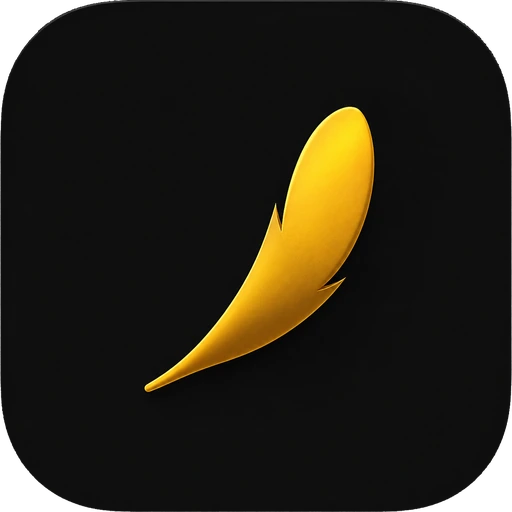

# Classinus: Frontend

[English version] · [Français](README.fr.md)

The frontend repository for **[Classinus](https://classinus.com)**. It contains the AI assistant and workspace interface, available on the web and as installable applications.

The same interface foundation powers the browser experience, Android and iOS apps, and the Windows desktop app.

[Official website](https://classinus.com) · [Backend repository](https://github.com/petitboura/classinus-backend) · [Français](README.fr.md)

## What's included

- **AI assistant:** conversations, model selection, and connected tools.
- **Personal workspace:** file library, notes, history, and personalization.
- **Media:** previews for documents, images, audio, video, and interactive content.
- **Connections:** integrations with external services and MCP servers.
- **Installable apps:** Android and iOS with Capacitor, Windows with Electron.

## Technology stack

Next.js 14 · React 18 · TypeScript · Tailwind CSS · Supabase JS · Capacitor 8 · Electron

## Run locally

Requirements: Node.js and npm.

```bash
npm install
```

Copy `.env.local.example` to `.env.local`, then fill in the required values:

| Variable | Purpose |
|---|---|
| `NEXT_PUBLIC_API_URL` | Classinus API URL |
| `NEXT_PUBLIC_SUPABASE_URL` | Supabase project URL |
| `NEXT_PUBLIC_SUPABASE_ANON_KEY` | Public Supabase anon key |
| `NEXT_PUBLIC_APP_URL` | Frontend URL |

Start the development server:

```bash
npm run dev
```

The app will be available at `http://localhost:3000`. The backend must be reachable at the address configured in `NEXT_PUBLIC_API_URL`.

## Useful commands

| Command | Purpose |
|---|---|
| `npm run dev` | Start the local development server |
| `npm run build` | Build the production web app |
| `npm start` | Serve the web build |
| `npm run build:capacitor` | Create the static build and sync Capacitor |
| `npm run build:capacitor:test` | Build Capacitor for the configured test environment |
| `npm run test:composants-natifs` | Check native components |
| `npm run test:couleurs-theme` | Check theme colors |

The build script also runs the checks configured in `prebuild`.

## Documentation

Full documentation index: [English](docs/README.md) · [Français](docs/README.fr.md).


| Guide | What it covers |
|---|---|
| [Architecture](docs/ARCHITECTURE.md) · [Français](docs/ARCHITECTURE.fr.md) | Frontend responsibilities, code organization, and backend communication |
| [Development](docs/DEVELOPPEMENT.md) · [Français](docs/DEVELOPPEMENT.fr.md) | Setup, configuration, commands, and tests |
| [Platforms](docs/PLATEFORMES.md) · [Français](docs/PLATEFORMES.fr.md) | Web, Android, iOS, and Windows |
| [Technical code map](docs/CARTOGRAPHIE_TECHNIQUE.md) · [Français](docs/CARTOGRAPHIE_TECHNIQUE.fr.md) | Where to find code by feature |
| [Windows app publishing](docs/appli-pc-mise-a-jour-et-publication.md) · [Français](docs/appli-pc-mise-a-jour-et-publication.fr.md) | Build and update the Windows app |
| [Store submission tracking](docs/soumission-stores.md) · [Français](docs/soumission-stores.fr.md) | Mobile release checklist, to be revalidated before submission |
| [Bambara voice mode](docs/VOIX_BAMBARA.md) | microphone, Soloni, AI, Gemini voice chain, and the "Bambara or other" question |

## Related repositories

- **Frontend, this repository:** [petitboura/classinus-frontend](https://github.com/petitboura/classinus-frontend)
- **Backend API:** [petitboura/classinus-backend](https://github.com/petitboura/classinus-backend)

Implementation details belong in `docs/` or next to the relevant code. This README is the project's entry point.
