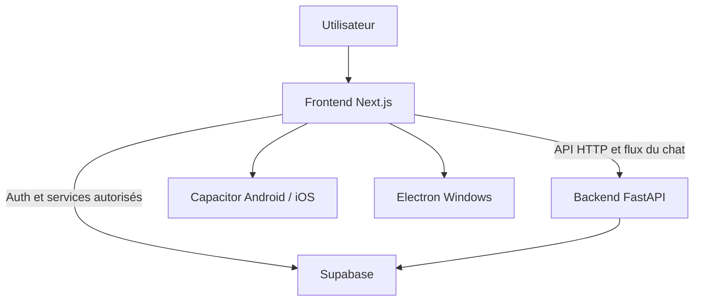

> [English version](./ARCHITECTURE.md) · **Version française**

# Architecture du frontend

## Rôle

Ce dépôt contient l’interface de Classinus. Il ne contient pas le moteur API principal : les opérations métier et les fonctions serveur sont exposées par [classinus-backend](https://github.com/petitboura/classinus-backend).

Le projet Next.js sert l’application Web. Une configuration de build distincte produit une sortie statique destinée aux projets natifs Capacitor. L’application Windows s’appuie sur Electron et sur les mêmes composants d’interface.

## Vue d’ensemble

Le navigateur, les applications mobiles et l’application Windows partagent l’essentiel de l’interface. Les capacités propres à chaque plateforme passent par les couches natives correspondantes.

## Organisation du dépôt

| Chemin | Responsabilité |
|---|---|
| `app/` | routes Next.js, pages publiques, écrans connectés et layouts |
| `components/` | composants d’interface partagés |
| `components/chat/` | conversation, saisie, pièces jointes et rendu des réponses |
| `components/mobile/` | navigation et comportement propres aux interfaces mobiles |
| `lib/` | logique cliente, état partagé, accès API, configuration et utilitaires |
| `types/` | types TypeScript partagés |
| `public/` | logos, icônes, polices et ressources statiques |
| `android/`, `ios/` | projets natifs Capacitor |
| `electron/` | processus et intégration de l’application Windows |
| `packages/` | extensions Capacitor locales, notamment pour Electron |
| `tests/` | vérifications automatisées et garde-fous du frontend |

## Échanges avec les services

- `NEXT_PUBLIC_API_URL` définit l’adresse de l’API FastAPI.
- `NEXT_PUBLIC_SUPABASE_URL` et `NEXT_PUBLIC_SUPABASE_ANON_KEY` configurent le client Supabase du navigateur.
- `NEXT_PUBLIC_APP_URL` sert notamment à construire les URLs absolues du site.
- Les clés privées des fournisseurs IA et les secrets du backend ne doivent jamais être ajoutés au frontend.

Les variables sont détaillées dans [.env.local.example](../.env.local.example) et dans le [guide de développement](DEVELOPPEMENT.md).

## Configuration de build

`next.config.mjs` distingue le build Web normal de l’export statique utilisé pour Capacitor. Sans `CAPACITOR_BUILD=true`, le comportement Web reste celui de Next.js. Le script `build:capacitor` active l’export, puis synchronise le résultat dans les projets natifs.

La configuration Capacitor se trouve dans `capacitor.config.ts`. La configuration Electron est dans `electron/` et les extensions propres au bureau dans `packages/`.

## Règles de maintenance

1. Une évolution d’interface partagée doit rester compatible avec les environnements qui réutilisent le frontend.
2. Les appels métier et l’accès privilégié aux données restent côté backend.
3. Toute nouvelle capacité native doit être vérifiée sur la plateforme cible, pas seulement dans le navigateur.
4. Les détails propres à un composant doivent être documentés près du composant ou dans un guide spécialisé, pas dans le README racine.
