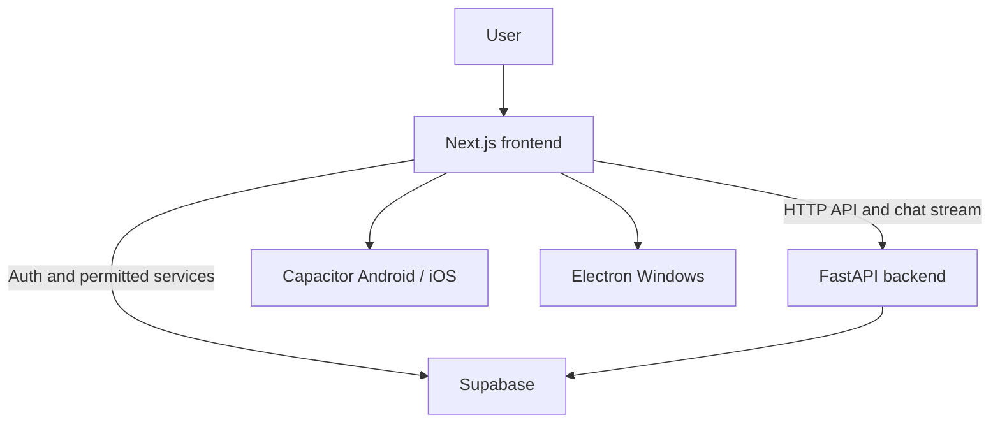

# Frontend architecture

[English version] · [Français](ARCHITECTURE.fr.md)

[English version] · [Français](ARCHITECTURE.fr.md)

## Purpose

This repository contains the Classinus interface. It does not contain the main API engine: business operations and server-side functions are provided by [classinus-backend](https://github.com/petitboura/classinus-backend).

The Next.js project serves the web app. A separate build configuration produces a static export for the Capacitor native projects. The Windows app uses Electron and the same interface components.

## Overview

The browser, mobile apps, and Windows app share most of the interface. Platform-specific capabilities are handled by the corresponding native layers.

## Repository structure

| Path | Responsibility |
|---|---|
| `app/` | Next.js routes, public pages, authenticated screens, and layouts |
| `components/` | Shared interface components |
| `components/chat/` | Conversation, input, attachments, and response rendering |
| `components/mobile/` | Navigation and behavior specific to mobile interfaces |
| `lib/` | Client-side logic, shared state, API access, configuration, and utilities |
| `types/` | Shared TypeScript types |
| `public/` | Logos, icons, fonts, and static assets |
| `android/`, `ios/` | Capacitor native projects |
| `electron/` | Windows desktop integration and main process |
| `packages/` | Local Capacitor extensions, including Electron plugins |
| `tests/` | Automated checks and frontend safeguards |

## Service communication

- `NEXT_PUBLIC_API_URL` defines the FastAPI address.
- `NEXT_PUBLIC_SUPABASE_URL` and `NEXT_PUBLIC_SUPABASE_ANON_KEY` configure the browser Supabase client.
- `NEXT_PUBLIC_APP_URL` is used to build absolute site URLs.
- Private AI provider keys and backend secrets must never be added to the frontend.

The variables are listed in [.env.local.example](../.env.local.example) and the [development guide](DEVELOPPEMENT.md).

## Build configuration

`next.config.mjs` distinguishes the normal web build from the static export used by Capacitor. Without `CAPACITOR_BUILD=true`, Next.js keeps its standard web behavior. The `build:capacitor` script enables the export and then syncs the output into the native projects.

Capacitor is configured in `capacitor.config.ts`. Electron is configured in `electron/`, with desktop-specific extensions in `packages/`.

## Maintenance principles

1. Shared interface changes must remain compatible with every environment that reuses the frontend.
2. Business operations and privileged data access stay in the backend.
3. Every new native capability must be tested on its target platform, not only in a browser.
4. Component-level details belong near the component or in a specialized guide, not in the root README.
